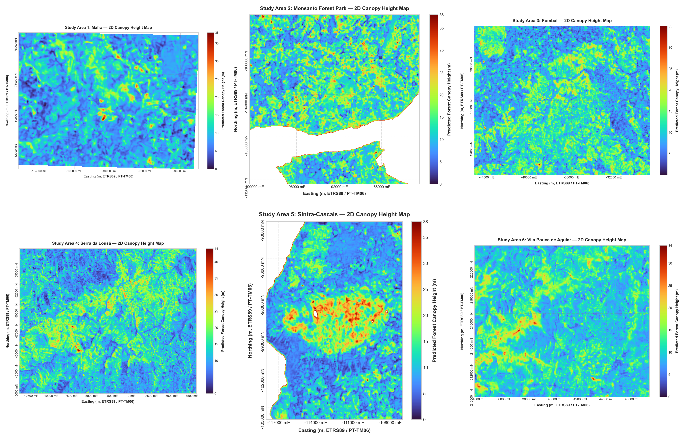
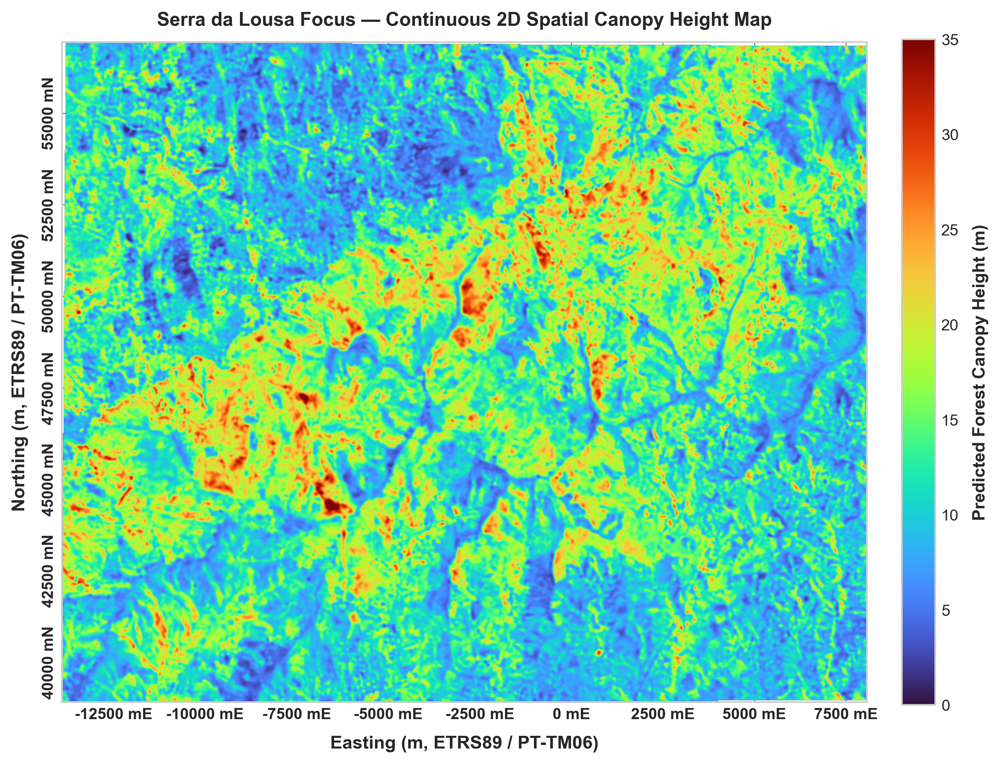

# Multi-Sensor Deep Learning for Forest Canopy Height Estimation

[](https://www.python.org/downloads/)
[](https://pytorch.org/)
[](https://opensource.org/licenses/MIT)

Official code repository accompanying the Master's Dissertation:
> **"Deep Learning Approaches for Multi-Sensor Forest Canopy Height Estimation"**  
> *NOVA School of Science and Technology (NOVA FCT)*, Lisbon, Portugal.

This repository provides an end-to-end framework to process multi-sensor Earth Observation (EO) data (**Sentinel-1 SAR**, **Sentinel-2 Multispectral**, and **ALOS-2 PALSAR-2**) paired with reference **LiDAR / GEDI $\mathrm{RH}_{98}$** footprints to estimate continuous 2D **Forest Canopy Height (FCH)** across diverse bioclimatic regions in mainland Portugal.

---

## 🏛️ Comprehensive Architectural Progression

All model tiers described and evaluated in Chapters 4, 5, and 6 of the dissertation are implemented in [`models/models.py`](models/models.py):

| Model Tier | Fusion Paradigm | Attention & Spatial Mechanism | Parameters | Dissertation Section |
| :--- | :---: | :---: | :---: | :---: |
| **Dummy Regressor** | None | Statistical Mean Baseline | 0 | Section 4.1.1 |
| **Minimalist CNN** | Early Fusion | Shallow 3-block Conv ($32 \to 64 \to 64$) | $\sim 65\text{K}$ | Section 4.1.2 |
| **SpatialCNN** | Early Fusion | Dilated Conv (dil=2) + Coarse $3\times3$ Grid Pool | $\sim 610\text{K}$ | Section 4.3 |
| **Late Fusion Base** | Late Fusion | Dedicated Sensor Branches | $\sim 850\text{K}$ | Section 4.4 |
| **Late Fusion + SE** | Late Fusion | Squeeze-and-Excitation (SE) Channel Attention | $\sim 890\text{K}$ | Section 4.4.1 |
| **Late Fusion Proposed** | Late Fusion | **SE Attention + Gaussian Center-Aware Spatial Pooling** | $\sim 890\text{K}$ | Section 4.4.2 |
| **Late Fusion Ensemble** | Late Fusion | Fold / Seed Averaging ($N \times$ Proposed) | $N \times 890\text{K}$ | Section 4.4.3 |

---

## 🔬 Experimental Pipeline & Key Findings

1. **Pre-processing, Interpolation & Alignment** (`preprocessing/`):
   - **Bicubic Spline Interpolation**: Accurate resampling between GEDI footprints and satellite grids.
   - **Multi-scale Patch Extraction**: Systematic extraction of $3\times3$, $5\times5$, $7\times7$, $11\times11$, $15\times15$, and $21\times21$ patches to quantify the effect of spatial context.
   - **Raster Alignment**: Automated harmonisation of multi-sensor bands into aligned stacks at 10 m resolution.

2. **Recursive Feature Elimination (RFE)** (`experiments/rfe/`):
   - Automated backward elimination pruning channels from 72 down to the optimal 42 bands.
   - Preserves high predictive power while removing redundant multi-temporal channels.

3. **Ablation Studies & Mitigation Strategies** (`experiments/ablations/`):
   - **Patch Size Ablation**: Demonstrates performance saturation at $11\times11$ ($110\times110\text{ m}$ ground footprint).
   - **Weighted Loss & Data Augmentation**: Resolves regression-to-the-mean tendencies on rare tall canopies ($>20\text{ m}$).
   - **Center Radius & Sensor Ablations**: Validates the superiority of combining local footprint focus with surrounding landscape context.

4. **Regional Deployment** (`inference/`):
   - High-throughput sliding-window inference generating continuous 2D GeoTIFF canopy height maps for 6 Portuguese study regions: **Mafra**, **Monsanto**, **Pombal**, **Serra da Lousã**, **Sintra-Cascais**, and **Vila Pouca de Aguiar**.

---

## 🗺️ Visual Results

### Continuous 2D Canopy Height Prediction Across Study Regions
<p align="center">
  
</p>

### Detailed Zoom: Serra da Lousã Complex Relief
<p align="center">
  
</p>

---

## 📂 Repository Structure

```text
trabalho git/
├── models/
│   └── models.py                 # All 7 architectures (Dummy, Minimalist, SpatialCNN, Late Fusion variants, Ensemble)
│
├── preprocessing/
│   ├── interpolation/            # Bicubic interpolation routines for multi-source alignment
│   ├── patch_extraction/         # Footprint-centered patch generation (variable sizes)
│   └── raster_alignment/         # Automated raster alignment and stacking
│
├── experiments/
│   ├── rfe/                      # Recursive Feature Elimination scripts, curves & summary
│   ├── ablations/                # Patch size, SE attention, weighted loss, and center-aware ablations
│   ├── cross_validation/         # Stratified and LORO cross-validation workflows
│   ├── baseline_metrics/         # CSV metrics and evaluation summaries across baselines
│   └── data_audit/               # Complete dataset audit (channels, missing values, height bins)
│
├── inference/
│   ├── late_fusion.py            # Deployment architecture definition
│   ├── estimate_region.py        # Sliding-window inference on regional GeoTIFFs
│   ├── process_all_regions.py    # Batch inference across all 6 study areas
│   └── train_deployment_model.py # Full dataset retraining script
│
├── pretrained_weights/
│   ├── final_model_deploy.pt     # Pre-trained PyTorch weights for immediate deployment
│   ├── mean.pt                   # Per-channel normalisation means
│   └── std.pt                    # Per-channel normalisation standard deviations
│
├── figures_and_plots/
│   ├── scripts/                  # Standalone scripts to reproduce all Chapter 6 thesis figures
│   └── output_figures/           # High-resolution rendered plots and 2D canopy height maps
│
├── geo_data/
│   ├── portugal_osm.geojson      # Study area vector boundaries
│   ├── portugal-districts.json   # District boundaries
│   └── generate_study_areas_map.py
│
├── requirements.txt              # Environment dependencies
├── LICENSE                       # MIT License
└── README.md                     # Project documentation
```

---

## 🛠️ Quickstart & Usage

### 1. Installation
```bash
git clone https://github.com/guilherme-bento/forest-canopy-height-deeplearning.git
cd forest-canopy-height-deeplearning

python -m venv venv
# Windows:
.\venv\Scripts\activate
# Linux/macOS:
source venv/bin/activate

pip install -r requirements.txt
```

### 2. Using the Models in Python
```python
import torch
from models.models import LateFusionSpatialCNN_CenterAware, infer_late_fusion_channel_groups

# Define channel layout (e.g. 42 channels)
channel_names = [...] # list of band names
groups = infer_late_fusion_channel_groups(channel_names)

# Instantiate the proposed Center-Aware Late Fusion architecture
model = LateFusionSpatialCNN_CenterAware(in_channels=42, channel_groups=groups)
model.eval()

# Input patch: (Batch, Channels, Height, Width) -> e.g. (1, 42, 11, 11)
x = torch.randn(1, 42, 11, 11)
height_pred = model(x)
print(f"Predicted Canopy Height: {height_pred.item():.2f} m")
```

### 3. Regional Inference
To generate a 2D wall-to-wall canopy height map for a target region (e.g. `SerraLousa_2020`):
```bash
python inference/estimate_region.py SerraLousa_2020
```

### 4. Reproducing Thesis Figures
All charts and figures presented in Chapter 6 can be regenerated by running:
```bash
python figures_and_plots/scripts/gerar_todos_os_graficos_da_tese.py
```

---

## 📜 Citation

```bibtex
@mastersthesis{bento2026canopyheight,
  author       = {Guilherme Bento},
  title        = {Deep Learning Approaches for Multi-Sensor Forest Canopy Height Estimation},
  school       = {NOVA School of Science and Technology (NOVA FCT)},
  year         = {2026},
  address      = {Caparica, Portugal}
}
```

---

## 📄 License
This project is licensed under the [MIT License](LICENSE).
